# Changelog

Each version gets a GitHub release with these notes and its screenshots. Screenshots of
every screen, light and dark, are in [docs/screenshots](docs/screenshots).

<!-- Each "## x.y" heading becomes a release named vx.y.0. "commit:" pins the release to
     an older commit; without it the release points at the merge that added the heading. -->

## 0.5

Optional backup and caregiver sharing, through a server you run yourself. Off unless you turn it on.

  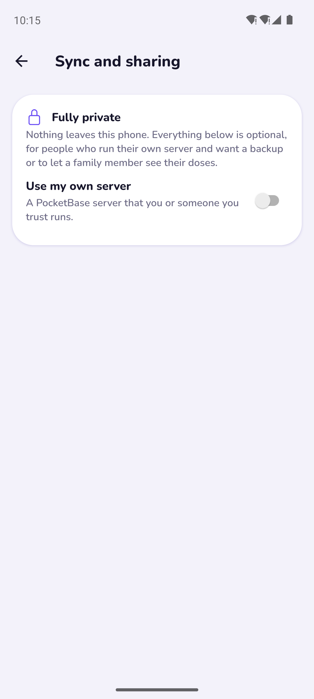
  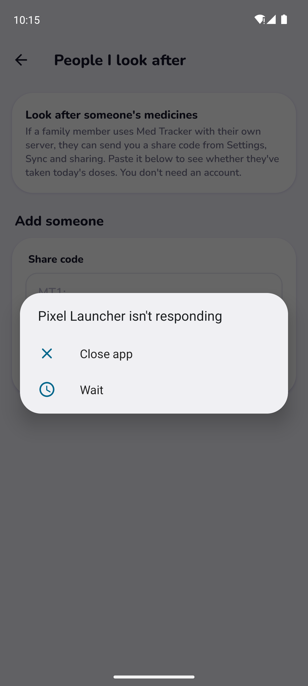
  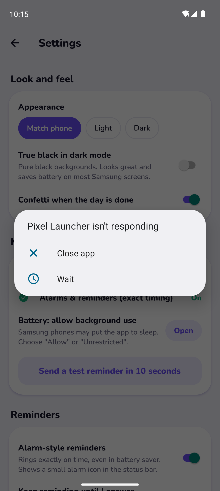

### Added
- Sync and sharing (Settings): connect to a PocketBase server you host. Nothing changes until you do; with it off, nothing leaves the phone.
- Encrypted backup: your medicines, history and notes, locked on the phone with a recovery key only you have, so the server stores data it can't read. Restore it on a new phone with the key.
- Caregiver sharing: send a family member a share code and they can see today's and yesterday's doses and your week. Medicine names are left out unless you include them. Making a new code cuts off the old one.
- People I look after: paste someone's code to follow their doses, with an optional alert when a dose hasn't been marked a while after it was due. No account needed.
- A setup guide and ready-made collection for the server in `server/`.

## 0.4

Share your history with your doctor, and add medicines by scanning the box.

  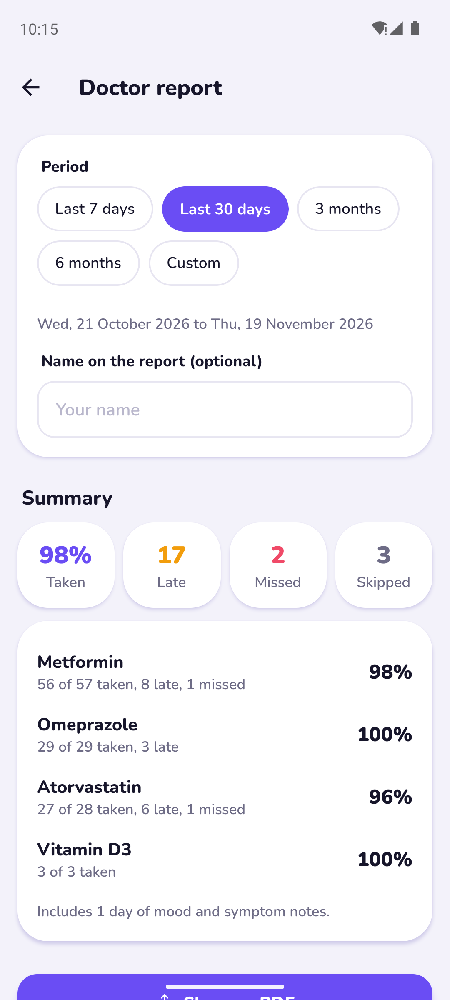
  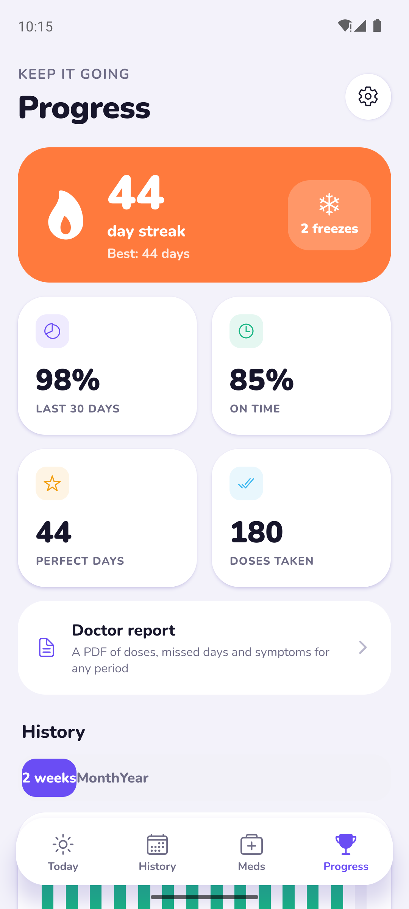
  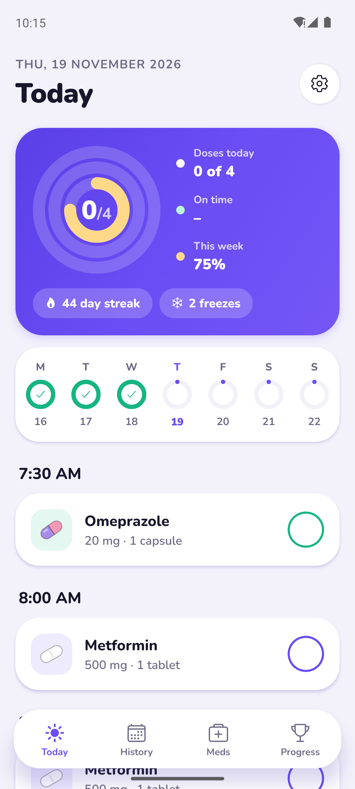

### Added
- Doctor report: a PDF for the last week, month, 3 or 6 months or any dates you pick. It lists each medication with doses due, taken, late, skipped and missed, a day-by-day grid, the missed doses, and mood and symptom notes. Made on the phone and shared only where you choose. You can print it too.
- Scan the box: take a photo of a medicine box and the app reads the name, strength, form and pack size on the phone (Google's on-device text recognition) to fill in the form. Scanning a box you already have offers to add the pack to its stock.
- A bigger home screen widget listing every dose today, with Take on each one that's due.

### Changed
- The small widget uses one calm colour instead of a purple-pink gradient.

## 0.3

Reminders that fit real life: different times on different days, Ramadan, travel and busy weeks.

  
  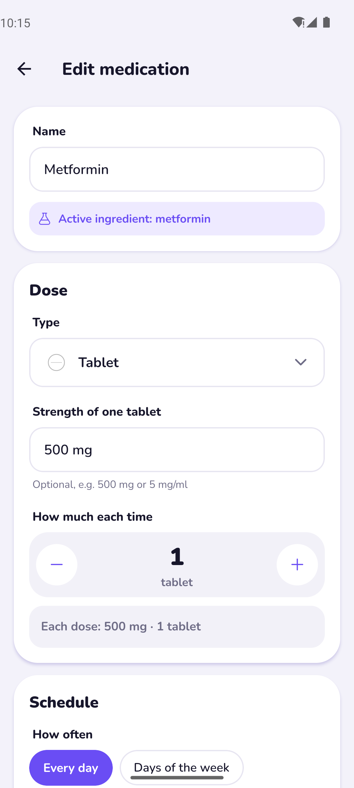
  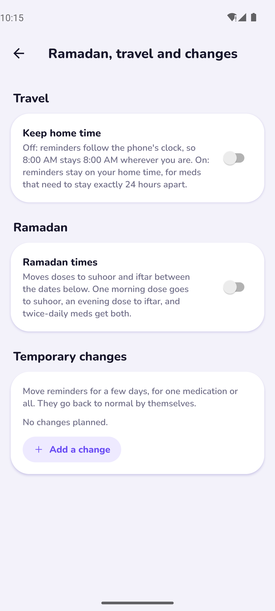
  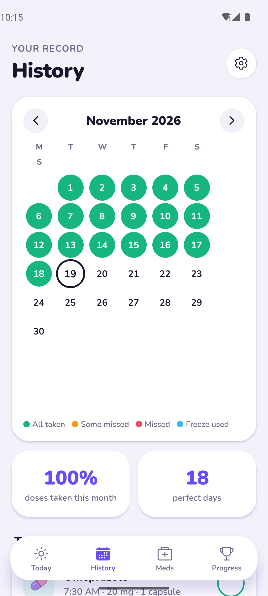

### Added
- Different times on some weekdays, for example 6:45 on office days and 10:00 at the weekend. A dose moved this way still counts as the same dose.
- Temporary changes: "from 24 to 30 Nov, remind me at 9:00 instead of 8:00", or shift every dose by up to two hours, for one medication or all. They end by themselves.
- Ramadan mode with start and end dates and a choice of medications. Doses move to suhoor and iftar, using times you set or times worked out from your city's prayer times on the phone, with no internet needed.
- Travel mode: keep reminders on home time while abroad. When the phone's time zone changes, the app tells you what will happen.
- Snooze for 10 minutes, 30 minutes or an hour from a dose's menu in the app.
- Quiet hours with no repeat reminders at night, repeat reminders that come sooner each time, and an evening check listing anything not logged yet.
- Mood (1 to 5), symptoms and a note for each day, on Today and in History.
- A photo of each pill, kept on the phone only and shown on Today.

### Changed
- Long-pressing a dose opens a menu with Taken, snooze times, Skip and Undo.
- Doses moved from their usual time say so on Today.

## 0.2.1
commit: 9279d64ed0b0155e51846447c595529cb11f8415

Pick what each medicine looks like, and an easier medicine form.

### Added
- Choose the shape (round, oval, oblong, capsule, square, diamond, triangle) and colour of each pill, with two colours for capsules. Bottles, pens, inhalers and other forms are drawn in the colour you pick. The drawing shows on Today and Medications.
- A Smartwatch section in Settings explaining how to turn on reminders for a Galaxy Watch.

### Changed
- The medicine type is a dropdown instead of a sideways-scrolling row, and suggested strengths wrap onto several lines so none are hidden.
- The colour that was on the medicine form is now called the accent colour.

## 0.2
commit: b93ed248d30b6928f5613d150c4256930a4966a0

The new look, dose amounts that match the box, medicine search and interaction checks.

  
  
  
  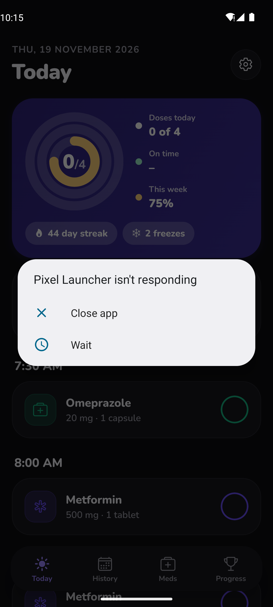

### Added
- Light, dark and true-black modes, following the phone or picked in Settings.
- New design: Nunito font, rounded cards, animated rings and check buttons, confetti when the day is done (can be turned off).
- Dose as strength plus amount, for example 500 mg, 3 tablets. Refills count by the amount, and half tablets and ml work.
- Medicine search: built-in UAE brands plus the US RxNorm list, filling in the ingredient and strengths.
- Interaction check against your other meds, alcohol and food, with a clear "not complete, ask your doctor" note.
- Pause a medication for a while without breaking the streak.
- 7-day squares on each medication, and month and year heatmaps on the Progress tab.
- Home screen widget with today's progress and a Take button.
- Optional release signing so updates install over each other.

### Changed
- Icons instead of emojis everywhere, and calmer colours.
- Progress moved to its own tab.

### Removed
- Room decorating, for now. Coins are still counted in case it comes back.

### Fixed
- The home screen widget showed a blank box.
- History stays when a medication is deleted.

## 0.1
commit: c22ec81cf21bd9634260f4d9885a3cba65dd3019

The first version.

  
  
  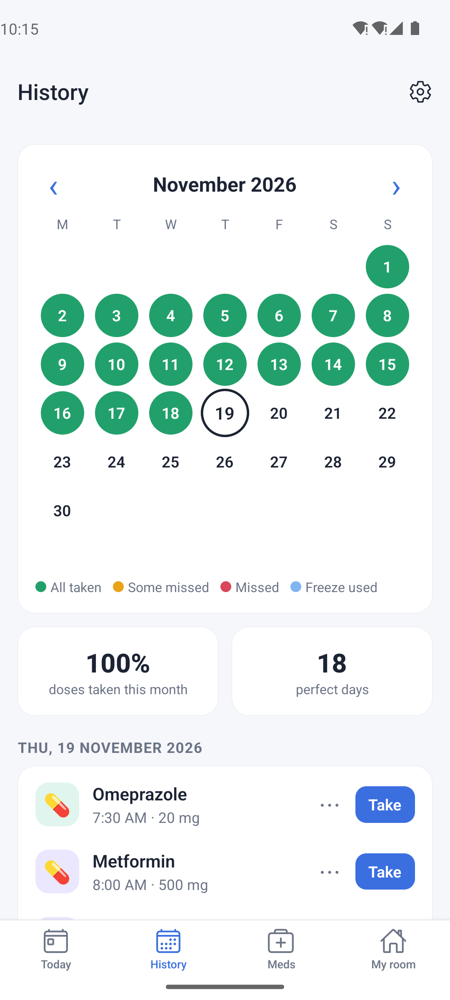
  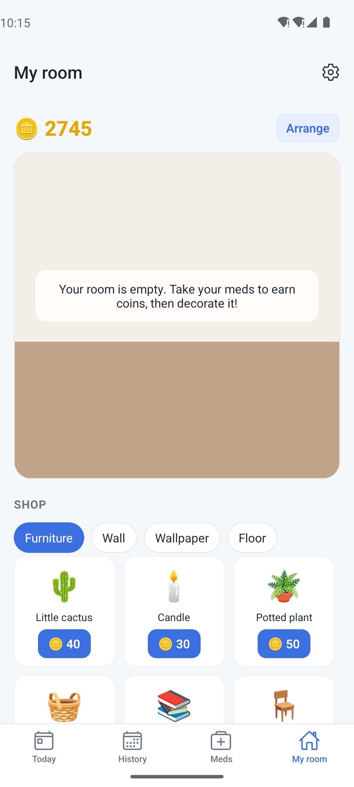

### Added
- Schedules: daily, chosen weekdays, every N days or weeks, on/off cycles, monthly and as needed, several times a day.
- Reminders with Taken, Snooze and Skip buttons, alarm-clock delivery and repeat reminders until answered.
- Today screen with rings, and a History calendar where any day can be fixed.
- Stock tracking with refill alerts.
- Streaks where late doses count, streak freezes and badges.
- A room to decorate with coins earned from doses.
- Backup to a file and restore.
