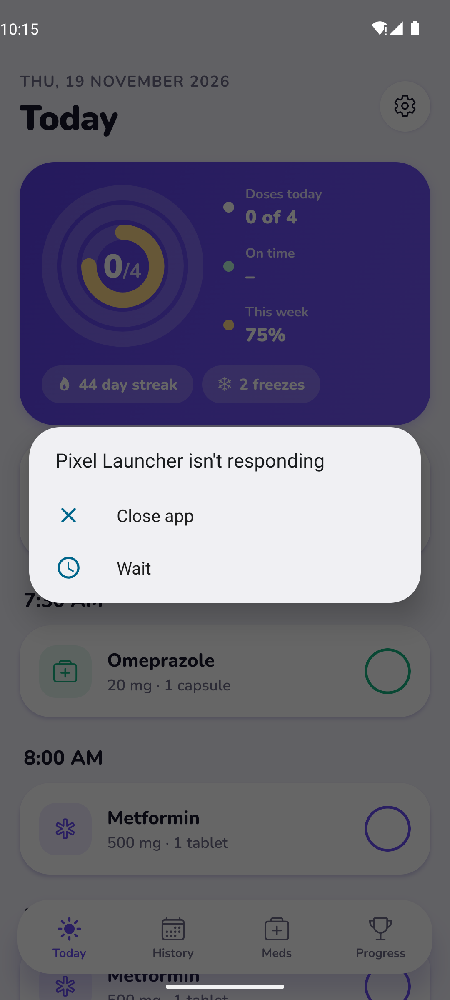
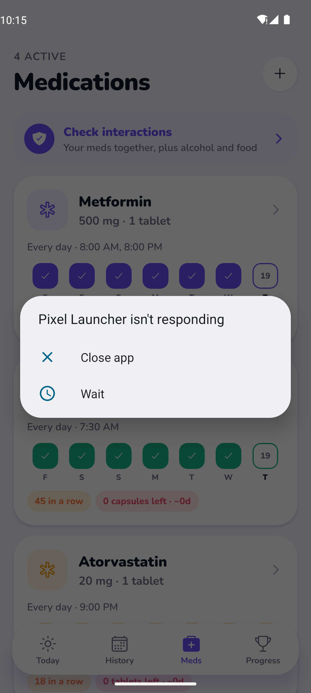
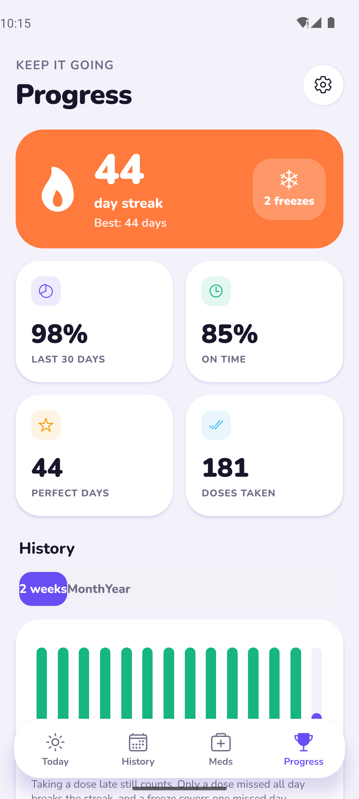
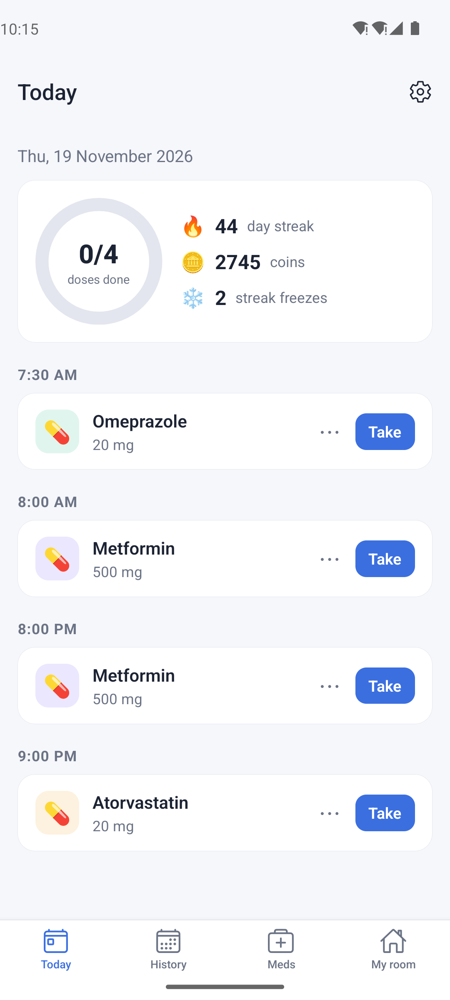
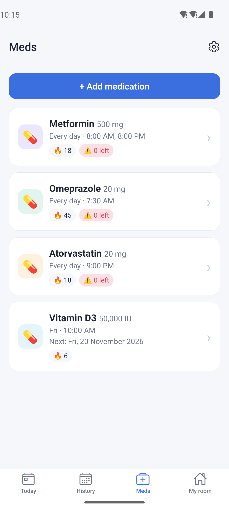

# Changelog

Each version gets a GitHub release with these notes and its screenshots. Screenshots of
every screen, light and dark, are in [docs/screenshots](docs/screenshots).

<!-- Each "## x.y" heading becomes a release named vx.y.0. "commit:" pins the release to
     an older commit; without it the release points at the merge that added the heading. -->

## 0.2.1

Pick what each medicine looks like, and an easier medicine form.

### Added
- Choose the shape (round, oval, oblong, capsule, square, diamond, triangle) and colour of each pill, with two colours for capsules. Bottles, pens, inhalers and other forms are drawn in the colour you pick. The drawing shows on Today and Medications.
- A Smartwatch section in Settings explaining how to turn on reminders for a Galaxy Watch.

### Changed
- The medicine type is a dropdown instead of a sideways-scrolling row, and suggested strengths wrap onto several lines so none are hidden.
- The colour that was on the medicine form is now called the accent colour.

## 0.2
commit: b93ed248d30b6928f5613d150c4256930a4966a0

The new look, dose amounts that match the box, medicine search and interaction checks.

  
  
  
  

### Added
- Light, dark and true-black modes, following the phone or picked in Settings.
- New design: Nunito font, rounded cards, animated rings and check buttons, confetti when the day is done (can be turned off).
- Dose as strength plus amount, for example 500 mg, 3 tablets. Refills count by the amount, and half tablets and ml work.
- Medicine search: built-in UAE brands plus the US RxNorm list, filling in the ingredient and strengths.
- Interaction check against your other meds, alcohol and food, with a clear "not complete, ask your doctor" note.
- Pause a medication for a while without breaking the streak.
- 7-day squares on each medication, and month and year heatmaps on the Progress tab.
- Home screen widget with today's progress and a Take button.
- Optional release signing so updates install over each other.

### Changed
- Icons instead of emojis everywhere, and calmer colours.
- Progress moved to its own tab.

### Removed
- Room decorating, for now. Coins are still counted in case it comes back.

### Fixed
- The home screen widget showed a blank box.
- History stays when a medication is deleted.

## 0.1
commit: c22ec81cf21bd9634260f4d9885a3cba65dd3019

The first version.

  
  
  
  

### Added
- Schedules: daily, chosen weekdays, every N days or weeks, on/off cycles, monthly and as needed, several times a day.
- Reminders with Taken, Snooze and Skip buttons, alarm-clock delivery and repeat reminders until answered.
- Today screen with rings, and a History calendar where any day can be fixed.
- Stock tracking with refill alerts.
- Streaks where late doses count, streak freezes and badges.
- A room to decorate with coins earned from doses.
- Backup to a file and restore.
