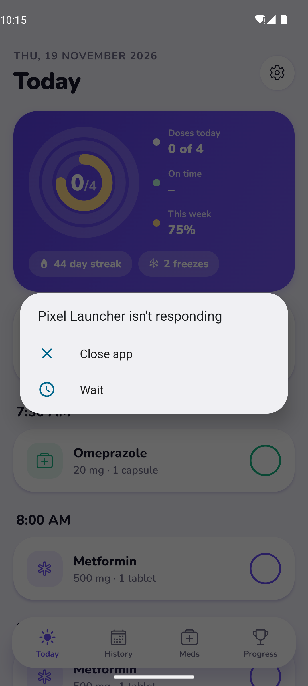
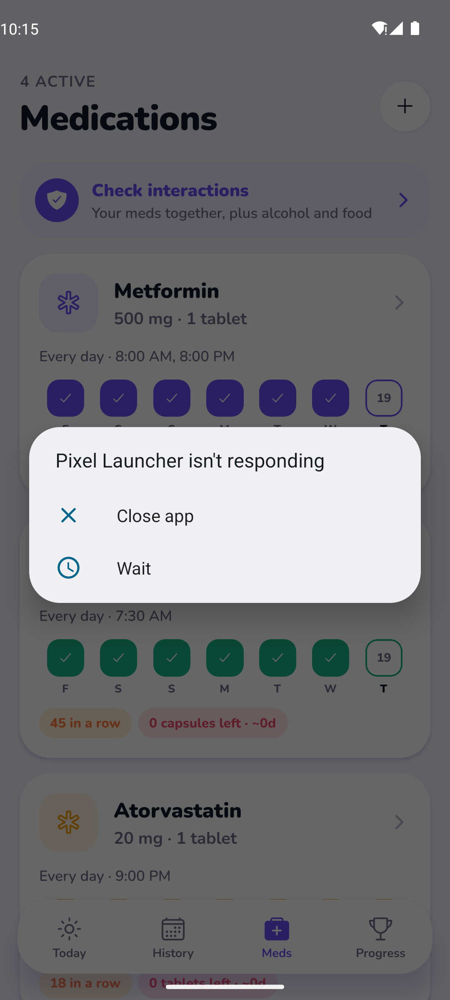
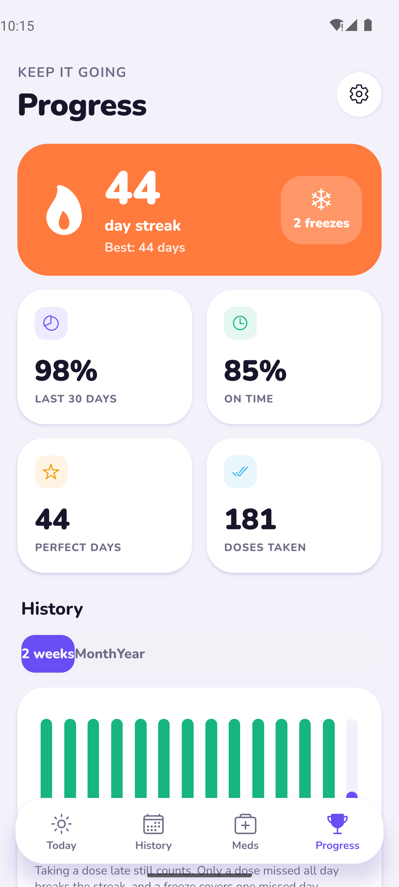
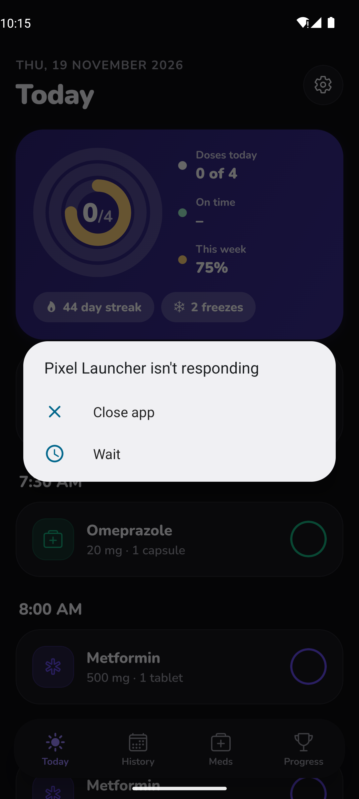
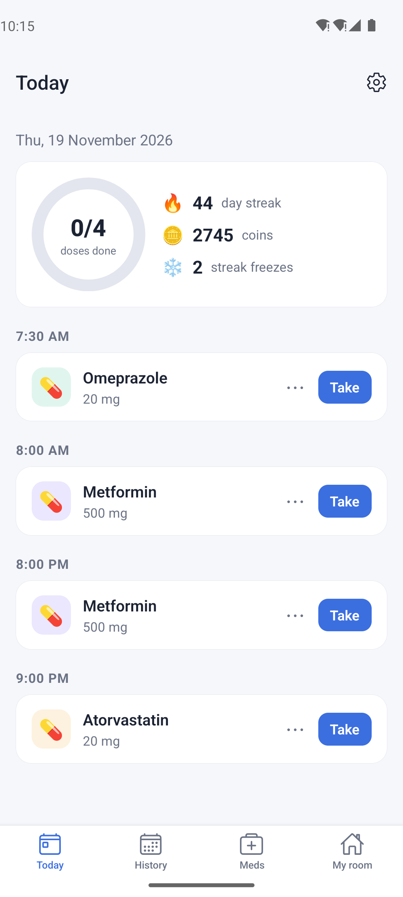
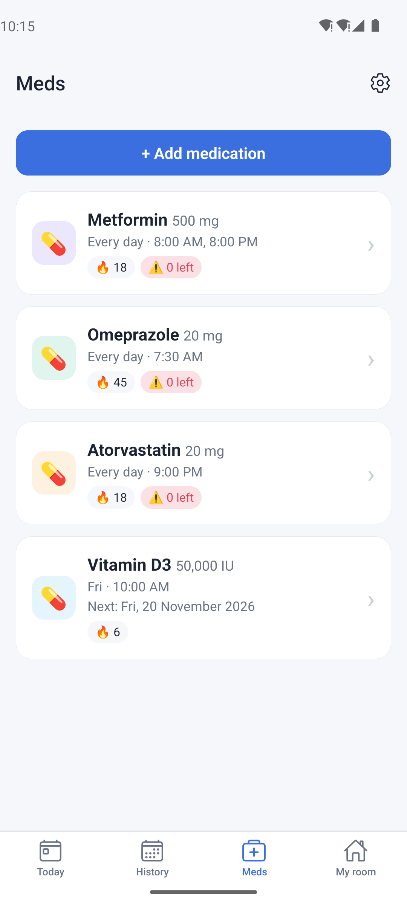
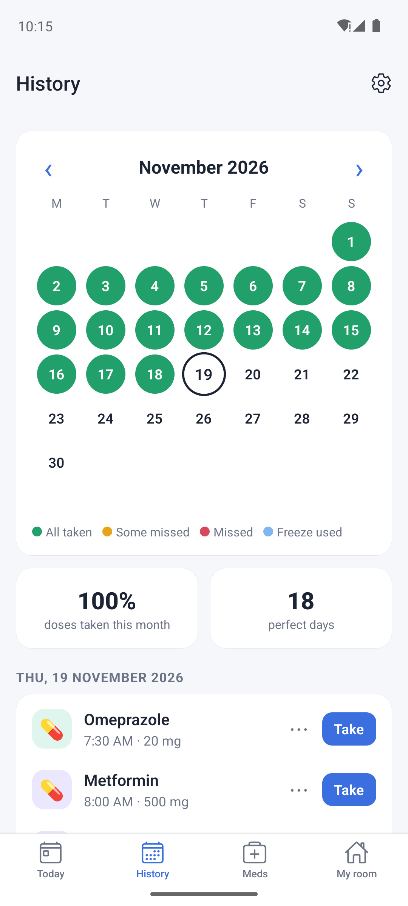
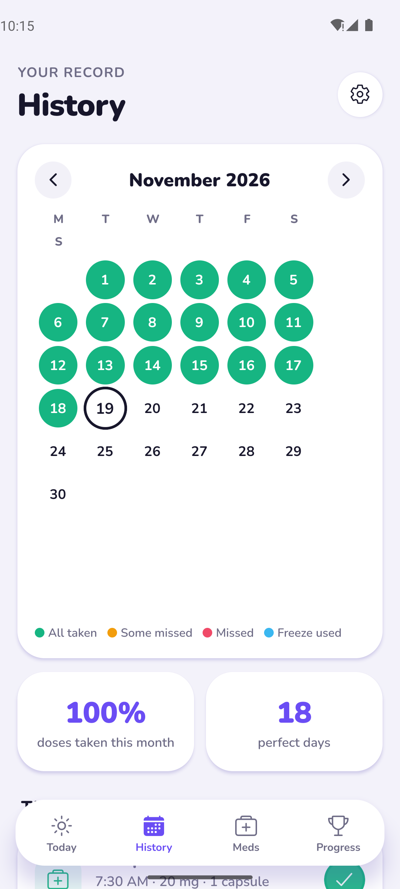
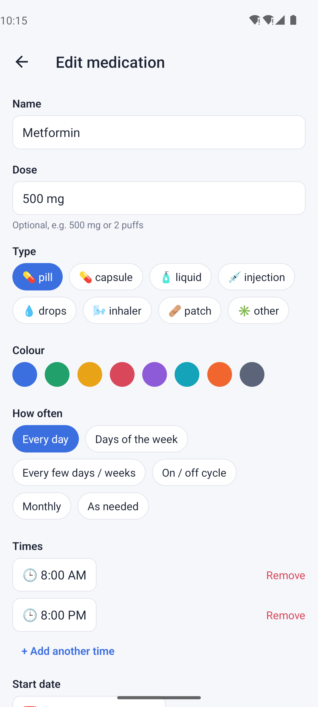
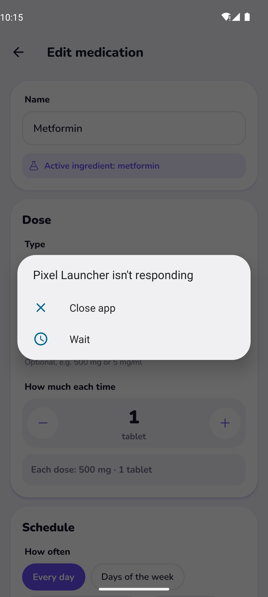

# Sabr: Medicine Tracker

Do you struggle to take your meds on time? Do you forget how many tablets you're meant to take, and when? Have you ever stood in the kitchen wondering whether you actually took this morning's dose, or just thought about taking it?

If you take one pill a day, a phone alarm is probably enough. Once it's five meds, some twice a day, one only on Fridays and one every other week, alarms stop being enough. You need something that knows the schedule, asks "did you take it?", and remembers the answer.

Sabr (صبر, "patience") is a free Android app that does that. It's a simple, private replacement for Samsung Health's Medications feature, which isn't available in every country (including the UAE, where this app started).

<p align="center">
  
  
  
  
</p>

## Features

**Schedules that fit real life.** Every day, chosen weekdays, every N days or weeks, on/off cycles (21 on, 7 off), monthly, or as needed. Each med can be due several times a day, with start and end dates. You can pause a med when your doctor says to stop for a week.

**Reminders you can answer from the notification.** Each one has Taken, Snooze and Skip buttons, so you don't need to open the app. Android's alarm-clock delivery means battery saver can't delay them, and they can repeat until you answer.

**A clear answer to "did I take it?"** The Today screen lists what's due and what's done. The History calendar colours every day, and you can tap any day to see or fix what was logged.

**Doses that match the box.** Strength and amount are separate, for example 500 mg, 3 tablets. Half tablets and ml work too. Stock is counted in tablets, and you get a refill alert with roughly how many days are left.

**Medicine search.** Start typing a brand or generic name. It searches a built-in list of common UAE brands (Panadol, Adol, Concor, Glucophage...) and the US RxNorm list, then fills in the active ingredient and the strengths it comes in.

**Interaction check.** Checks your meds against each other, alcohol and food, using a short built-in list and the official US drug labels (openFDA). It isn't a complete list, and the app says so.

**Streaks that are fair.** A dose taken late still counts. Only a dose never taken that day breaks the streak, and streak freezes cover the odd bad day. Rings, a 7-day row for each med, month and year heatmaps and badges show how you're doing.

**A home screen widget** with today's progress and a Take button for the next dose.

**Light, dark and true-black modes.**

**Private by default.** No account and no server. Doses and history stay on the phone. Only medicine names leave it, when you search or check interactions. You can export everything to a file and restore it on a new phone.

## How it has changed

Screenshots of every version are kept in [docs/screenshots](docs/screenshots), taken on the same emulator with the same demo data, so you can compare them side by side.

| | 0.1 | 0.2 |
|---|---|---|
| Today |  |  |
| Medications |  |  |
| History |  |  |
| Edit a medication |  |  |

- **0.1** (Nov 2026): first version. Schedules, reminders with Taken/Snooze/Skip, history calendar, refills, streaks, badges and a room to decorate with earned coins.
- **0.2** (Nov 2026): new design with light and dark mode, dose as strength plus amount, medicine search, interaction check, home screen widget, pausing a med, heatmaps. Room decorating removed for now.

## What's next

- **0.3:** different times on different weekdays, temporary time changes, travel and Ramadan modes, better snooze, mood and symptom notes, pill photos.
- **0.4:** a doctor report PDF for any period, scanning the box to add a med, a bigger widget.
- **0.5:** caregiver mode through a self-hosted PocketBase server, and a Galaxy Watch tile.

## Install on Android

1. Open the [latest release](../../releases/tag/latest) on your phone and download the `.apk`.
2. Open it. Android will ask you to allow installs from your browser or files app; allow it once.
3. In the app, open **Settings** and:
   - allow **Notifications** and **Alarms & reminders**;
   - tap **Battery → Open** and choose *Unrestricted*. On Samsung phones, also check *Settings → Battery → Background usage limits* and make sure Sabr isn't in "Sleeping apps";
   - tap **Send a test reminder** to check it works.

Builds from pull requests are under the **Actions** tab, as the `med-tracker-apk` artifact.

> Sabr is a reminder tool, not medical advice. Always follow your doctor's or pharmacist's instructions.

## Development

```bash
npm install
npm test            # schedule, streak and reminder logic
npm run typecheck
npx expo run:android   # needs Android Studio / an Android device
```

The app uses native modules (notifications, SQLite, background tasks), so it needs a development build. Expo Go won't run it.

### Layout

- `src/domain/`: pure logic, fully unit tested
  - `schedule.ts`: when doses are due
  - `progress.ts`: day summaries, streaks, freezes, badges
  - `reminders.ts`: which notifications to schedule
  - `dose.ts`: strength × amount, units, days of supply
  - `interactions.ts`: built-in interactions and reading drug-label text
- `src/drugs/`: medicine search (built-in list + RxNav) and label lookups (openFDA)
- `src/widget/`: the Android home screen widget
- `src/db/`: SQLite storage
- `src/notifications/`: scheduling, the notification buttons, background tasks and permissions
- `src/app/`: screens (Expo Router)
- `.github/workflows/android.yml`: tests, then builds the APK and opens it on an emulator. Merges to `main` publish it as the `latest` release.
- `.github/workflows/screenshots.yml` and `scripts/screenshots/`: build each version with demo data and screenshot every screen in light and dark mode.

### Signing

Release APKs are signed with the app's own key when these repository secrets exist: `ANDROID_KEYSTORE_BASE64`, `ANDROID_KEYSTORE_PASSWORD`, `ANDROID_KEY_ALIAS`, `ANDROID_KEY_PASSWORD`. Without them the build falls back to the shared debug key.

### Data sources

- [RxNav / RxNorm](https://lhncbc.nlm.nih.gov/RxNav/) from the US National Library of Medicine: drug names, ingredients and strengths. Free, no key.
- [openFDA drug labels](https://open.fda.gov/apis/drug/label/): official US label text, read for interaction warnings. Free, no key (rate limited per phone).
