# Sabr: Medicine Tracker

Do you struggle to take your meds on time? Do you forget how many tablets you're meant to take, and when? Have you ever stood in the kitchen wondering whether you actually took this morning's dose, or just thought about taking it?

If you take one pill a day, a phone alarm is probably enough. Once it's five meds, some twice a day, one only on Fridays and one every other week, alarms stop being enough. You need something that knows the schedule, asks "did you take it?", and remembers the answer.

Sabr (صبر, "patience") is a free, open-source Android app that does that. It's a simple, private replacement for Samsung Health's Medications feature, which isn't available in every country (including the UAE, where this app started).

<p align="center">
  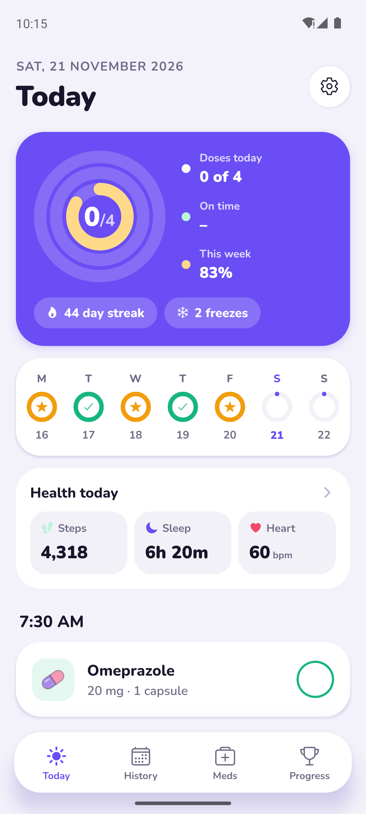
  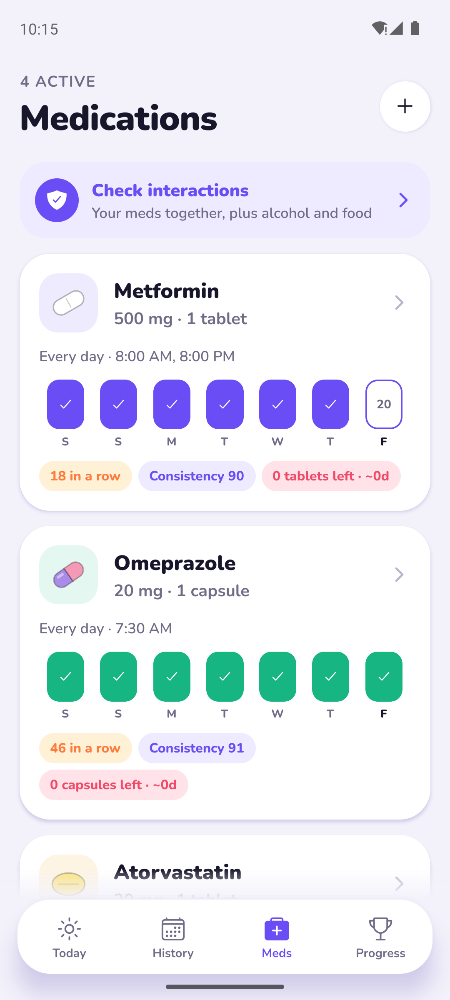
  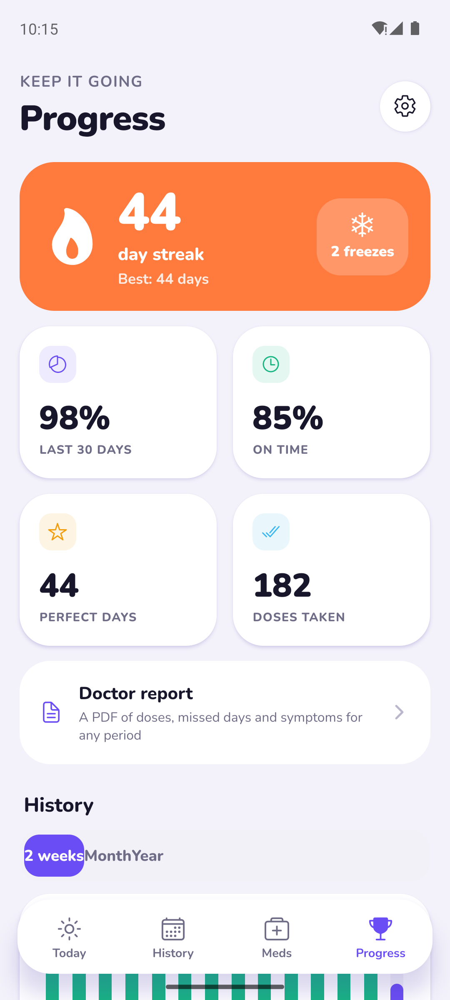
  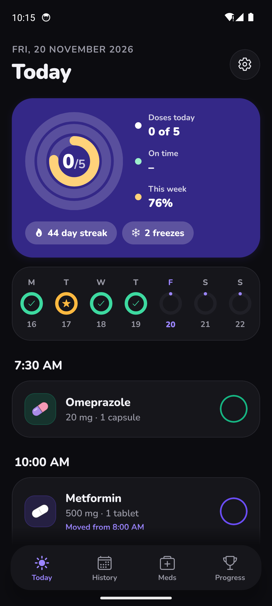
</p>

## Features

**Schedules that fit real life.** Every day, chosen weekdays, every N days or weeks, on/off cycles (21 on, 7 off), monthly, or as needed. Each med can be due several times a day, with start and end dates. You can pause a med when your doctor says to stop for a week.

<p>
  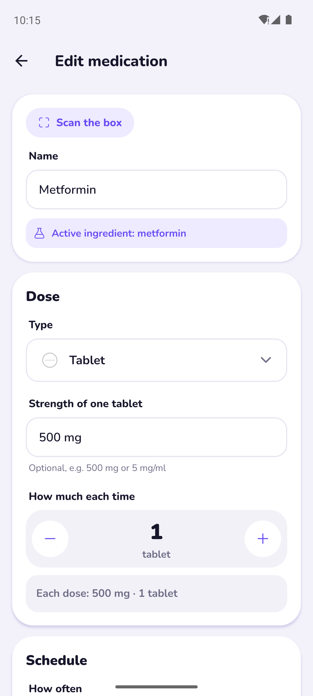
</p>

**Times that follow your week.** Set different times on office days and at the weekend, move reminders for a busy week, keep home time while travelling, and switch on Ramadan mode to move doses to suhoor and iftar (from times you set or your city's prayer times, worked out on the phone).

<p>
  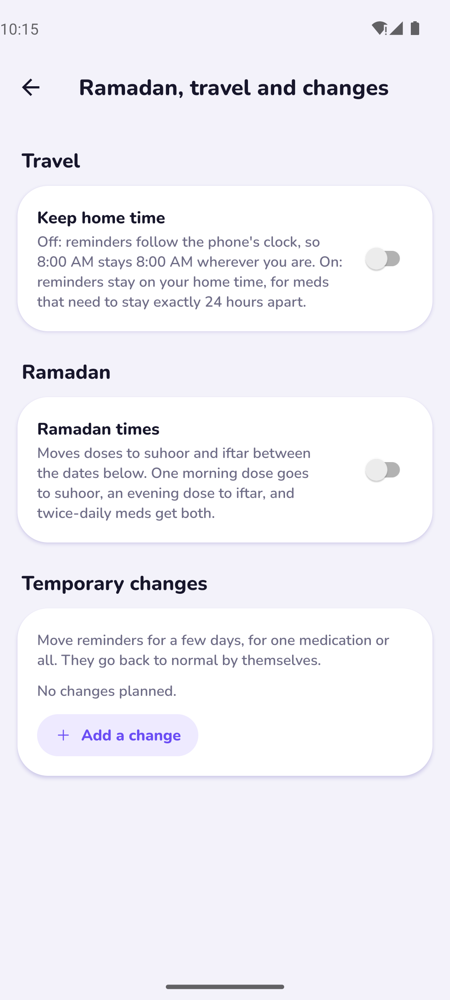
</p>

**Reminders you can answer from the notification.** Each one has Taken, Snooze and Skip buttons, so you don't need to open the app. Android's alarm-clock delivery means battery saver can't delay them, and they can repeat until you answer.

<p>
  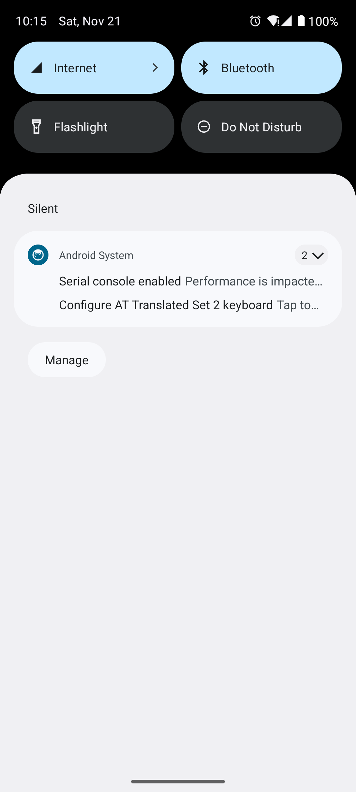
</p>

**Notes on how you feel.** A quick mood, symptoms like headache or nausea, and a few words for any day. Add a photo of each pill so they're easy to tell apart.

**A clear answer to "did I take it?"** The Today screen lists what's due and what's done. The History calendar colours every day, and you can tap any day to see or fix what was logged.

<p>
  
  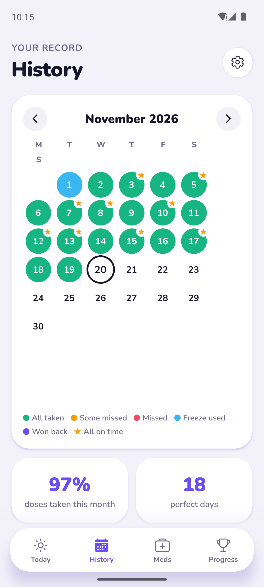
</p>

**Doses that match the box.** Strength and amount are separate, for example 500 mg, 3 tablets. Half tablets and ml work too. Stock is counted in tablets, and you get a refill alert with roughly how many days are left.

<p>
  
</p>

**Medicine search.** Start typing a brand or generic name. It searches a built-in list of common UAE brands (Panadol, Adol, Concor, Glucophage...) and the US RxNorm list, then fills in the active ingredient and the strengths it comes in.

**Interaction check.** Checks your meds against each other, alcohol and food, using a short built-in list and the official US drug labels (openFDA). It isn't a complete list, and the app says so.

<p>
  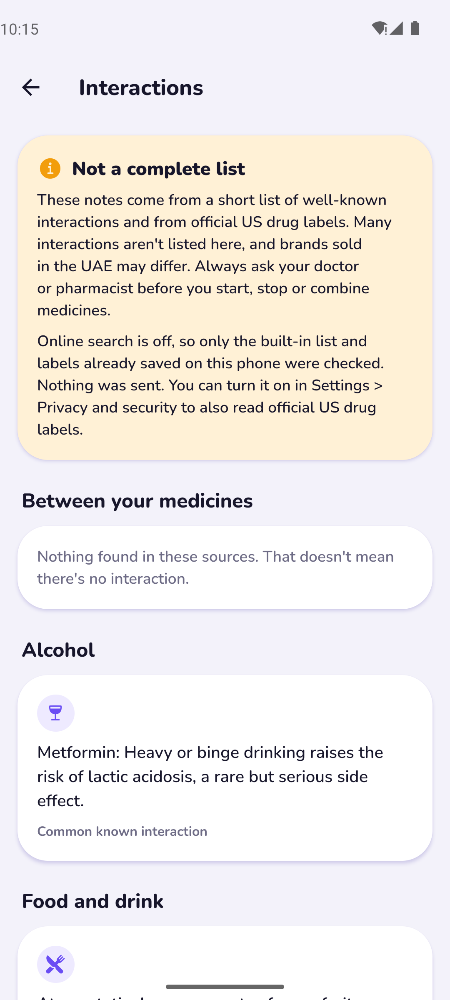
</p>

**Streaks that are fair.** A dose taken late still counts. Only a dose never taken that day breaks the streak, and streak freezes cover the odd bad day. Lost one anyway? Take every dose for the next 3 days and it comes back. Days you plan to skip (a test, a doctor's instruction) don't count against you at all. A consistency score, gold days (every dose on time), a perfect streak, milestones, rings, heatmaps and badges show how you're doing.

**Routines and timing.** Group medicines you take together, like Breakfast at 8:00, under one reminder with Take all. Empty-stomach medicines start a timer that tells you when you can eat. If you always take a dose 40 minutes after its reminder, Sabr offers to move the reminder.

**Month and year in review, and patterns.** A page on how each month and year went, and a view that lines up your mood and symptom notes with missed doses. All worked out on the phone.

<p>
  
</p>

**Reports for your doctor.** A PDF for any period with what was taken, late or missed, day by day, plus your mood and symptom notes.

<p>
  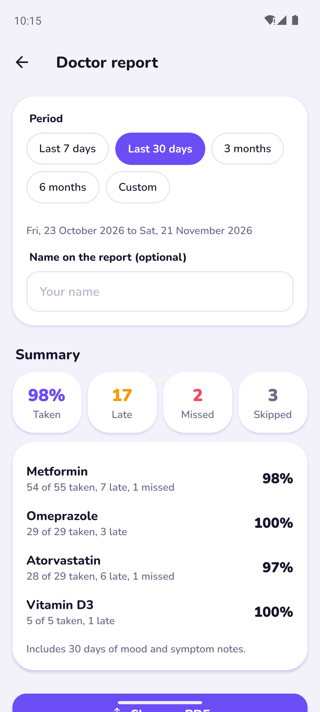
</p>

**Scan the box** to fill in a new medicine: the name, strength and pack size are read on the phone.

**Home screen widgets**: Next dose (small, with Taken and Snooze), Today (your rings and the next dose) and Today's list (every dose). Each one adapts when resized, turns green when the day is done and gold when every dose was on time. Medicine names stay off the widget unless you turn them on.

**Galaxy Watch / Wear OS tile** (optional): today's ring, the next dose and Taken / Snooze on your watch. Setup: [docs/watch.md](docs/watch.md).

**Light, dark and true-black modes.**

<p>
  
  
</p>

**Free and open source.** The full source is here, under the GPL-3.0 licence (see below). Anyone can read how it works, build it themselves, or improve it.

**Private by default.** No account and no server. Doses and history stay on the phone. Online medicine search and medicine names in reminders are off until you turn them on, and Google's cloud backup is turned off for the app. Back up to a password-locked file (save it to Google Drive or anywhere you like, or let Sabr write one to a folder every week) and restore it on a new phone. An optional app lock asks for your fingerprint, face or phone PIN.

<p>
  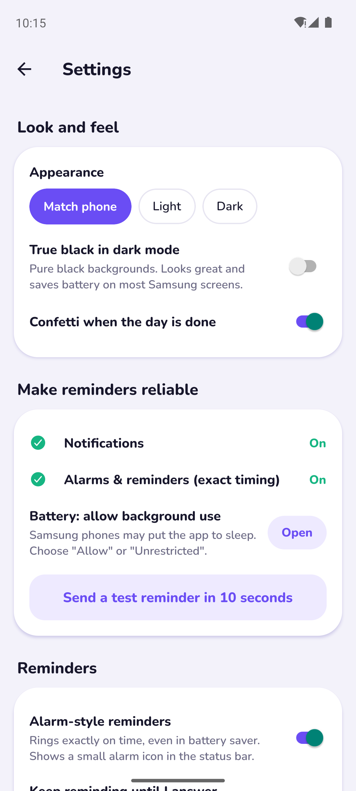
</p>

**Optional backup and caregiver sharing, on your own server.** If you run a [PocketBase](https://pocketbase.io) server, the app can keep an encrypted backup there, and let a family member see whether today's doses were taken. Everything is encrypted on the phone first, so the server can't read it, and medicine names are only shared if you choose. Both are off until you turn them on. Setup: [server/README.md](server/README.md).

<p>
  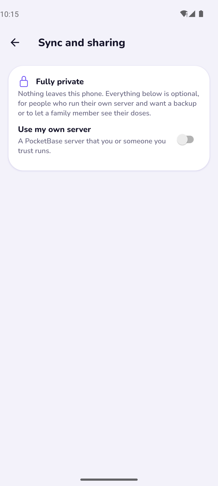
  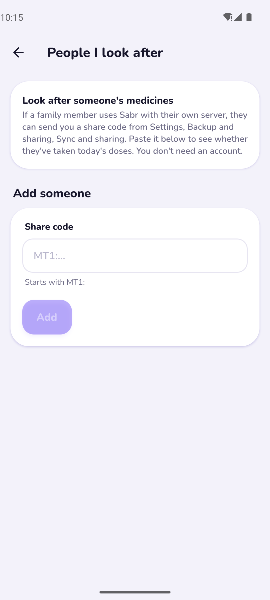
</p>

## Versions

Every version's notes, APK and screenshots (light and dark, every screen) are on the [Releases](../../releases) page.

## Privacy

No accounts, ads, analytics or crash reports, and your data stays on your phone. Anything that could share or show what you take is off until you turn it on in Settings > Privacy: online medicine search (sends only a medicine name to free US government services) and medicine names in reminders. See [PRIVACY.md](PRIVACY.md) for exactly what is sent and to whom.

## What's next

- **0.5.x:** fixes from testing 0.5 on a phone.

## Install on Android

1. Open the [latest release](../../releases/tag/latest) on your phone and download the `.apk`.
2. Open it. Android will ask you to allow installs from your browser or files app; allow it once.
3. In the app, open **Settings** and:
   - allow **Notifications** and **Alarms & reminders**;
   - tap **Battery → Open** and choose *Unrestricted*. On Samsung phones, also check *Settings → Battery → Background usage limits* and make sure Sabr isn't in "Sleeping apps";
   - tap **Send a test reminder** to check it works.

Builds from pull requests are under the **Actions** tab, as the `med-tracker-apk` artifact.

> Sabr is a reminder tool, not medical advice. Always follow your doctor's or pharmacist's instructions.

## Development

```bash
npm install
npm test            # schedule, streak and reminder logic
npm run typecheck
npx expo run:android   # needs Android Studio / an Android device
```

The app uses native modules (notifications, SQLite, background tasks), so it needs a development build. Expo Go won't run it.

### Layout

- `src/domain/`: pure logic, fully unit tested
  - `schedule.ts`: when doses are due
  - `progress.ts`: day summaries, streaks, freezes, badges
  - `reminders.ts`: which notifications to schedule
  - `dose.ts`: strength × amount, units, days of supply
  - `interactions.ts`: built-in interactions and reading drug-label text
- `src/drugs/`: medicine search (built-in list + RxNav) and label lookups (openFDA)
- `src/widget/`: the Android home screen widget
- `src/wear/` and `modules/sabr-wear/`: sends today's summary to the watch tile and handles its buttons
- `wear/`: the Wear OS watch app with the Sabr tile ([docs/watch.md](docs/watch.md))
- `src/db/`: SQLite storage
- `src/notifications/`: scheduling, the notification buttons, background tasks and permissions
- `src/app/`: screens (Expo Router)
- `.github/workflows/android.yml`: tests, then builds the APK and opens it on an emulator. Merges to `main` publish it as the `latest` release.
- `.github/workflows/screenshots.yml` and `scripts/screenshots/`: build each version with demo data and screenshot every screen in light and dark mode.

### Signing

Release APKs are signed with the app's own key when these repository secrets exist: `ANDROID_KEYSTORE_BASE64`, `ANDROID_KEYSTORE_PASSWORD`, `ANDROID_KEY_ALIAS`, `ANDROID_KEY_PASSWORD`. Without them the build falls back to the shared debug key.

### Data sources

- [RxNav / RxNorm](https://lhncbc.nlm.nih.gov/RxNav/) from the US National Library of Medicine: drug names, ingredients and strengths. Free, no key.
- [openFDA drug labels](https://open.fda.gov/apis/drug/label/): official US label text, read for interaction warnings. Free, no key (rate limited per phone).

## Licence

Sabr is free and open-source software, released under the [GNU General Public License v3.0 or later](LICENSE). You can use, study, share and change it. If you share a changed version, it has to stay open source under the same licence.

Contributions are welcome: open an issue or a pull request.
